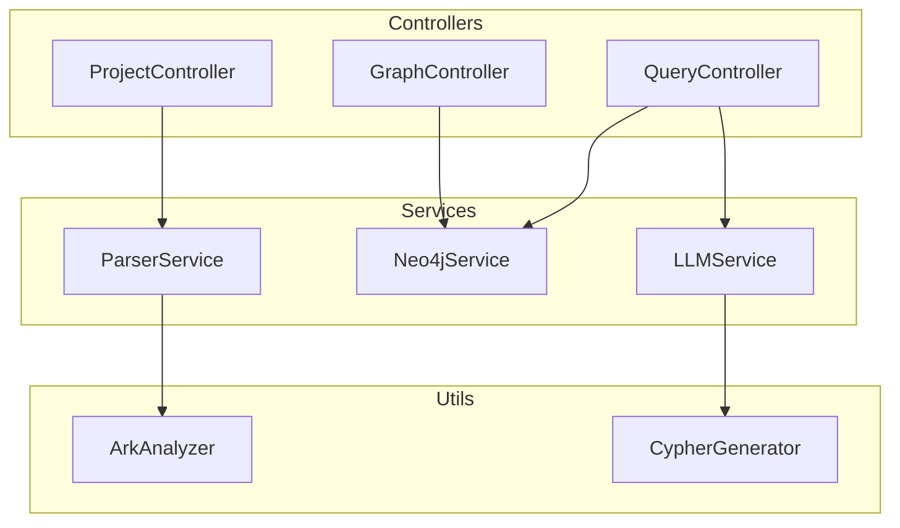

## 1. Architecture Design
```mermaid
flowchart LR
    subgraph Frontend["前端"]
        A[React App]
        B[Graph Visualization]
        C[Code Explorer]
        D[AI Query Interface]
        E[Dashboard]
    end
    
    subgraph Backend["后端"]
        F[Express API]
        G[ArkTS Parser]
        H[Neo4j Connector]
    end
    
    subgraph Database["数据库"]
        I[(Neo4j GraphDB]
    end
    
    subgraph External["外部服务"]
        J[OpenAI API]
    end
    
    A -->|HTTP| F
    F -->|解析| G
    F -->|查询| H
    H -->|Cypher| I
    F -->|LLM| J
```

## 2. Technology Description
- **Frontend**: React@18 + TypeScript + Vite + Tailwind CSS + Zustand + React Router
- **Backend**: Express@4 + TypeScript
- **Graph Database**: Neo4j (Community Edition
- **Graph Visualization**: react-force-graph-2d/3d
- **Code Highlighting**: react-syntax-highlighter
- **State Management**: Zustand
- **UI Icons**: lucide-react

## 3. Route Definitions
| Route | Purpose |
|-------|---------|
| / | Dashboard - 首页和项目概览 |
| /graph | 图谱可视化 |
| /explorer | 代码文件探索器 |
| /query | AI查询界面 |
| /settings | 设置页面 |
| /api/project | 项目相关API |
| /api/graph | 图谱查询API |

## 4. API Definitions

### TypeScript Types
```typescript
// 共享类型定义
interface FileNode {
  id: string;
  type: 'File' | 'Class' | 'Component' | 'Method';
  name: string;
  path?: string;
  file?: string;
  class?: string;
  isEntry?: boolean;
}

interface GraphLink {
  source: string;
  target: string;
  type: '包含' | '调用' | '包含组件';
}

interface GraphData {
  nodes: FileNode[];
  links: GraphLink[];
}

interface ProjectStats {
  files: number;
  classes: number;
  components: number;
  methods: number;
  entries: number;
}

// API 请求/响应类型
interface ParseProjectRequest {
  path: string;
}

interface ParseProjectResponse {
  success: boolean;
  stats: ProjectStats;
  data: GraphData;
}

interface QueryGraphRequest {
  query: string;
}

interface QueryGraphResponse {
  cypher: string;
  results: any[];
}
```

## 5. Server Architecture Diagram


## 6. Data Model
### 6.1 Data Model Definition
```mermaid
erDiagram
    FILE ||--o{ CLASS : contains
    FILE ||--o{ COMPONENT : contains
    CLASS ||--o{ METHOD : contains
    COMPONENT ||--o{ METHOD : contains
    METHOD ||--o{ METHOD : calls
    COMPONENT ||--o{ COMPONENT : contains
```

### 6.2 Neo4j Schema
```cypher
// 节点标签
:label File {
  path: String
}

:label Class {
  name: String,
  file: String
}

:label Component {
  name: String,
  file: String,
  isEntry: Boolean
}

:label Method {
  name: String,
  class: String
}

// 关系类型
:RELATIONSHIP CONTAINS
:RELATIONSHIP CALLS
:RELATIONSHIP CONTAINS_COMPONENT
```
