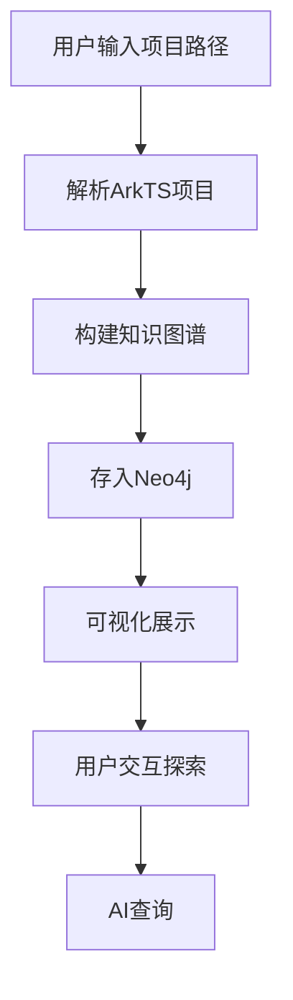

## 1. Product Overview
ArkTS代码转Neo4j知识图谱可视化平台，帮助开发者将鸿蒙项目代码转换为交互式知识图谱，提供直观的代码结构探索、关系分析和AI查询功能。

## 2. Core Features

### 2.1 Feature Module
1. **Dashboard**: 项目概览、统计数据、最近活动
2. **Graph Visualization**: 3D/2D交互式图谱可视化、节点关系探索、搜索筛选
3. **Code Explorer**: 代码文件树、文件内容查看、语法高亮
4. **AI Query**: 自然语言查询、Cypher生成、查询结果展示
5. **Settings**: Neo4j连接配置、项目设置、API密钥管理

### 2.3 Page Details
| Page Name | Module Name | Feature description |
|-----------|-------------|---------------------|
| Dashboard | Stats cards | 文件数、类数、组件数、方法数统计卡片 |
| Dashboard | Recent activity | 最近解析记录、查询历史 |
| Graph Visualization | Interactive canvas | 拖拽、缩放、节点交互 |
| Graph Visualization | Filter panel | 按类型筛选节点、按关系筛选 |
| Code Explorer | File tree | 项目文件夹树形结构 |
| Code Explorer | Code viewer | 语法高亮的代码查看器 |
| AI Query | Chat interface | 自然语言输入、查询结果展示 |

## 3. Core Process

## 4. User Interface Design
### 4.1 Design Style
- **主色调**: 深蓝 (#0f172a) + 科技蓝 (#3b82f6) + 青柠绿 (#10b981)
- **按钮风格**: 圆角矩形，悬停有深度感
- **字体**: 标题使用 Space Grotesk，正文使用 JetBrains Mono
- **布局风格**: 卡片式、侧边导航 + 主内容区
- **图标**: Lucide 图标库，科技感设计
- **背景**: 深色主题，渐变背景 + 噪点纹理

### 4.2 Page Design Overview
| Page Name | Module Name | UI Elements |
|-----------|-------------|-------------|
| Dashboard | Stats cards | 玻璃拟态卡片、渐变色、计数动画 |
| Graph Visualization | Canvas | 全屏画布、节点彩色区分、连线动画 |
| Code Explorer | File tree | 可折叠树、文件图标、高亮选中 |
| AI Query | Chat | 对话气泡、代码高亮、复制按钮 |

### 4.3 Responsiveness
- Desktop-first 设计，自适应平板和移动设备
- 侧边栏在小屏幕可折叠
- 触控优化的拖拽和缩放

### 4.4 3D Scene Guidance
- 使用 React Force Graph 实现 2D/3D 可视化
- 节点按类型着色：File(蓝), Class(紫), Component(青), Method(黄)
- 连线表示关系，粗细表示关联强度
- 悬停显示详情，点击高亮相关节点
- 相机平滑过渡，支持自动布局
